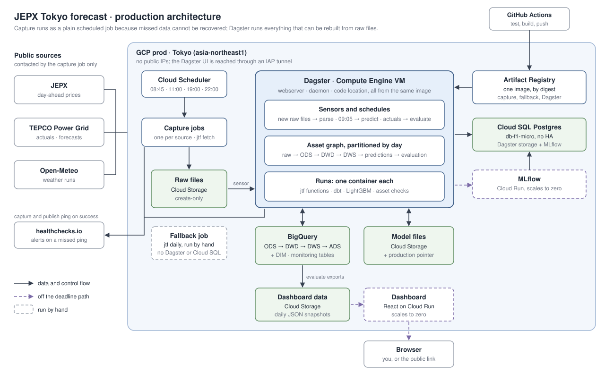
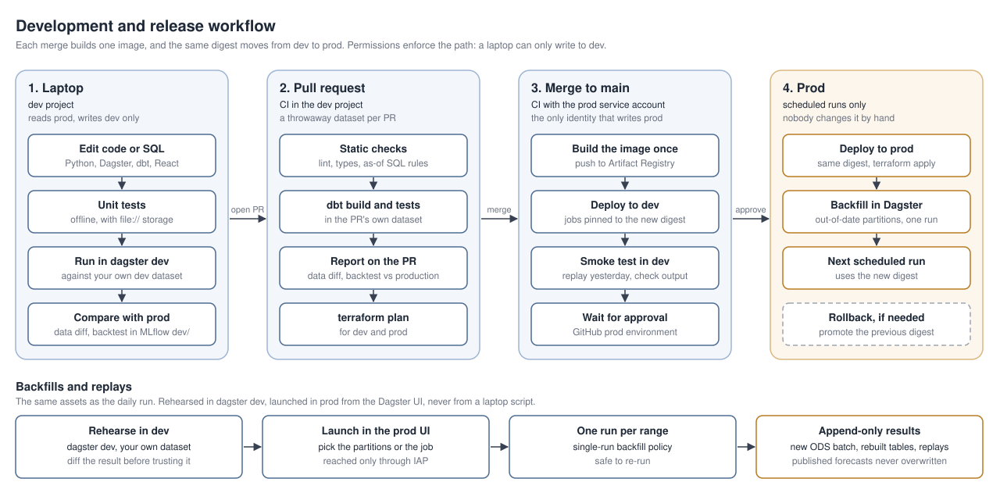
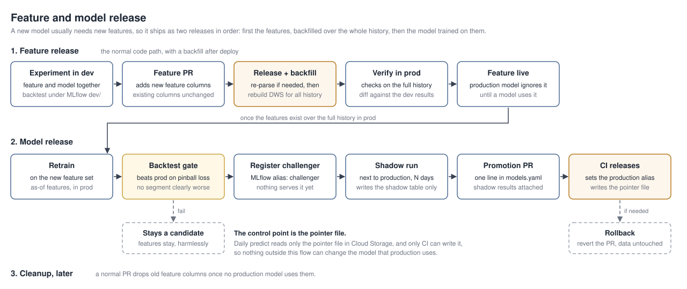

# PRD: Tokyo Day-Ahead Forecasting Platform

Nov 15, 2026 · @Junda

## Overview

Build one small but correct day-ahead forecasting platform for the Tokyo area on public data, host it on GCP for about $50 a month, then prove with planned failures that it detects problems, falls back and recovers.

**Why:** since the Feed-in Premium scheme, renewable generators and the aggregators that bundle them forecast their own output and market prices every day, and pay when forecasts miss. This project builds a small, honest version of that problem on public data, to practise the parts that decide whether forecasts hold up in production: point-in-time data, backtests without leakage, release gates, monitoring and recovery. It is also a learning project for energy-market mechanics, hands-on forecasting, dbt on BigQuery and AI-assisted ML operations.

**Goals**

- Daily ingestion of prices, grid actuals and weather forecasts, split into fetch (raw files kept as received) and parse (replayable), into an append-only, as-of warehouse
- Two forecasts for the next day's 48 half-hour slots, with P10/P50/P90 ranges: Tokyo-area solar output and Tokyo-area day-ahead price
- Point-in-time correctness as the core: every input carries when it became known, and a time machine rebuilds any past forecast exactly, or re-runs it with new code
- Capture runs as a plain scheduled job, because a missed capture loses data for good; everything that can be rebuilt from raw files runs as a Dagster asset graph, with lineage across Python and dbt, sensors and schedules, and partitioned backfills from a UI. All logic lives in the `jtf` package, which Dagster assets call
- Release gates, monitoring, a fallback ladder, tested database backups and an AI triage agent
- A library of fault scenarios, each with a written-up result
- Forkable: anyone can deploy their own copy into their own GCP account from a fork, with one config file and one bootstrap step
- GCP from day one, on common managed building blocks: Cloud Storage, BigQuery with dbt, Cloud Run, Compute Engine and Terraform, with Dagster for orchestration

**Non-goals**

- Beating professional forecasts. TEPCO's own forecast is a benchmark, not a target
- Plant-level forecasts. No public plant data, so area totals only
- Real bidding, trading or battery optimization
- Real-time serving. Batch runs with a deadline only
- Multi-vendor deploys. GCP is the only target; portability stops at one image, an environment-variable settings contract and storage addressed by URL

## Users and use cases

Three simulated roles shape the requirements; a fourth reader is anyone reviewing the repo and the incident write-ups.

| Role | What they need | What the platform gives |
| --- | --- | --- |
| Trader (consumer) | Next-day forecasts with ranges before the market deadline, and to know when a forecast is weaker | Forecast table per run with P10/P50/P90, model version and a fallback-level flag |
| Data scientist | Add a feature or model, backfill it, backtest without leakage, compare against production | `as_of`-driven features, the replay runner, shadow runs next to the live model |
| Operator (you) | Run the daily pipeline, hear about problems early, decide fast | Checks before the deadline, dashboards, an AI-drafted incident note, rollback by version |
| Reviewer | Evidence of judgment, not just setup | README design doc, fault scenarios with written results, honest status |

## Data sources and ingestion

Three free public sources (JEPX, TEPCO Power Grid and Open-Meteo) cover everything the two models need; each is fetched into Cloud Storage exactly as received, then parsed into ODS with the time it became known. Facts below were checked against the live sources on 2026-11-15.

| Source | What | Grain and units | Used for | Notes |
| --- | --- | --- | --- | --- |
| [JEPX spot summary](https://www.jepx.jp/electricpower/market-data/spot/): `spot_summary_{FY}.csv`, a form POST to `_download.php` | Day-ahead prices (system and 9 areas incl. Tokyo) and volumes | 30 min (slot codes 1–48); yen/kWh | Price target, price lags | One file per fiscal year (April start), Shift_JIS. Day D appears after the 10:00 auction on D−1; no sign of later changes. At most one download a day |
| [TEPCO area actuals](https://www.tepco.co.jp/forecast/html/area_jukyu-j.html): `eria_jukyu_YYYYMM_03.csv` | Demand and output by source, incl. solar (`太陽光発電実績`) and solar curtailment (`太陽光出力制御量`) | 30 min, labelled by slot start; **MW averaged over the slot** | Solar target, demand, residual load | One file per month, 30-min from Feb 2024, UTF-8 or CP932 depending on the file; yearly files for FY2016–2023 are hourly, in 万kWh, with a different layout ([history probe](../notebooks/01_history_probe.ipynb)). Updated every 30 min, within about 1 hour of delivery. **Past values are corrected silently and old values are not kept.** Generation includes estimates. Curtailment does happen (471 MW at 11:00 on 2026-11-07) |
| [TEPCO next-day forecast](https://www.tepco.co.jp/forecast/html/area-download-j.html): `AREA_ONCE_YOSOKU.csv`, `AREA_ONCE_BGKEI.csv` | TEPCO's forecast of area demand, total generation and **wind + solar combined** (no solar-only figure) | 30 min (`時間コマ` 1–48); **kWh per slot** | Benchmark for the solar model | **Published on the evening of D−1, after the gate closure. Live only until about 23:13, never archived**: history exists only from our first capture |
| TEPCO same-day files: `AREA_YOSOKU`, `AREA_BGKEI`, `AREA_JISEKI` (kWh per slot), `juyo-d1-j.csv` (hourly and 5-min, 万kW) | Same-day forecast, plan, actuals and demand outlook | 30 min, hourly, 5 min | Captured for future features, such as the D−1 demand outlook | Rewritten about every 30 minutes; the monthly archive keeps only the end-of-day version |
| [Open-Meteo Previous Runs API](https://open-meteo.com/en/docs/previous-runs-api) | Forecast values N days before each valid hour (`<var>_previous_day1` … `_previous_day7`); JMA MSM and GSM available | Hourly | Weather features for training and backtests | JMA models from 2018 (per the docs). The response has no run ID or issue time. Free for non-commercial use: 600 calls a minute, 10,000 a day |
| [Open-Meteo Single Runs API](https://open-meteo.com/en/docs/single-runs-api) | One whole model run, by its start time (UTC) | Hourly | Exact decision-time weather; measuring how pessimistic `previous_day2` is | Archive from 2026-04-02 only. Short MSM runs do not cover all of day D (the 21 UTC run ends at 21:00 JST on D) |
| Open-Meteo forecast API, live | The latest run at decision time | Hourly | Daily predict | Run identity and availability time are recorded only by our own capture |
| Holiday calendar (`jpholiday` Python package) | Japanese public holidays | Day | Holiday-aware lags, calendar features | Must be versioned like any other input |
| [Imbalance prices](https://www.imbalanceprices-cs.jp/) (phase 2) | Settlement price per slot | 30 min; yen/kWh excl. tax | Business cost of forecast errors | Monthly CSVs. Corrections replace values, but pre-correction data stays on the update history page, so it is safe to load later |

**Units and slot labels differ across sources**, even within TEPCO: MW averaged over the slot, kWh per slot (÷ 500 for MW) and 万kW (× 10 for MW); slots labelled by start time, by code 1–48, or as `0000`–`2400`. Parse keeps the source's values; DWD converts everything to MW and the slot's start time in JST, with range checks (F4, F5).

**Weather locations:** a handful of points across the Kanto prefectures, averaged by each prefecture's share of installed solar capacity as of `T`: the weights are data with their own `known_at`, not settings. TEPCO itself uses 63 forecast points ([OCCTO reference](https://www.occto.or.jp/assets/news/shutsuryokuyokusei_1/260701_sankoushiryo_tokyo.pdf)).

**Variables:** shortwave radiation (GHI), direct and diffuse radiation, cloud cover, 2 m temperature, 100 m wind speed.

**Ingestion design**

1. **Fetch:** download each source and store the file exactly as received in Cloud Storage, partitioned by extraction date. Never modified: writes are create-only (`if_generation_match=0`), so an existing file cannot be overwritten. The fetch time is the evidence for `known_at`; the response headers are stored with it. The parse step reads `source_time`: the update time written inside the file (TEPCO's area files carry one), else `Last-Modified`. External sources are pulled in full where it is cheap, so changes are detected by the parse step rather than trusted to the source's timestamps
2. **Parse:** turn stored raw files into ODS rows. When parse logic changes, it is replayed from Cloud Storage over any date range, never by re-fetching. `known_at` comes from the raw file, never from the time of parsing, so re-parsing history keeps it point-in-time correct
3. **Every ODS row carries its lineage:** `source_file`, `extraction_date`, `fetched_at`, `load_type` (daily, initial or recapture), `source_time` (the source's own published or updated time), `parser_version`, `ingested_at` and `batch_id`. ODS keeps the source's own values, units and time labels; DWD derives slot times, versions and `known_at`, because a version and its `known_at` depend on other captures of the same file

**Capture schedule.** It starts first, before anything else is built, because some data cannot be fetched later. About 10 small requests a day.

| When (JST) | What | Why |
| --- | --- | --- |
| 08:45 daily, just before the decision time | Current and previous month's `eria_jukyu`, since TEPCO keeps rewriting a month's file for weeks after it ends; `AREA_YOSOKU`, `AREA_BGKEI`, `AREA_JISEKI`, `juyo-d1-j.csv`; the latest Open-Meteo runs (JMA MSM and GSM, ECMWF IFS 0.25°) for the Kanto points | Exactly what was known at decision time, and real weather availability times. It runs before `T` so its `known_at` qualifies |
| 19:00 and 22:00 daily | `AREA_ONCE_YOSOKU`, `AREA_ONCE_BGKEI` | The only copy of TEPCO's next-day forecast; two captures until its publication time is known |
| 09:30 on the 1st of each month | Every monthly `eria_jukyu` file, with `If-Modified-Since`; only rewritten files are stored | Records TEPCO's occasional bulk rewrites of old months |
| 11:00 daily | JEPX spot summary for the current fiscal year | The day's auction result. Backfillable, but a daily capture records when it appeared |
| Once, then monthly | History: TEPCO actuals from FY2016, JEPX past fiscal years, Open-Meteo Previous Runs and Single Runs | The initial load, tagged `initial` |

A value is known from the first capture that contains it. Between captures `known_at` errs late, never early.

Capture is organised by source: one source file is one capture job (`jtf-fetch-<source>`), one schedule, one retry policy, one health check, one raw prefix, one Dagster raw asset and, later, one ODS table. A slow or failing source never affects another. The capture jobs run on Cloud Scheduler, outside Dagster, so a Dagster outage can never lose source data. They are the only part of the system that contacts the sources; Dagster sees each landed file through a sensor. The full list of sources and schedules is in the [phase 1 plan](phase1/README.md#capture-schedule).

**Before and after capture start:** history fetched in the initial load shows each source's current view of the past. From capture start, every version is recorded as it arrives.

| Source | Keeps past versions? | History before capture start |
| --- | --- | --- |
| Open-Meteo weather | Values by lead day, and whole runs since 2026-04-02, but not when each run became available | Conservative (`previous_day2`) or assumed availability delays |
| JEPX prices | Fixed once the auction clears | Accurate |
| TEPCO actuals | No: corrected silently in place | Final values; slightly optimistic, quantified by the optimism-gap experiment |
| TEPCO forecasts | No: not archived at all | None; the benchmark starts at capture start |

## Point-in-time correctness and the time machine

This is the core of the project: every input carries when it became known, every feature is built only from what was known at decision time, and any past forecast can be rebuilt exactly or re-run with new code. A leak here makes results look better and nobody notices, so it is enforced by one macro, CI rules and tests rather than by care.

**As-of rules**

1. **Decision time `T` is 09:00 JST on D−1**, one hour before the 10:00 JEPX gate closure. It is one setting, and every run and replay takes `T` explicitly; nothing reads the clock
2. **`known_at` is when we could have had the value:** the fetch time of the first capture containing it; or, for a value's first version when the rule's time falls before the source's capture start, the source's publication rule for history (table below). It is never the parse time
3. **A changed value is a new version** with its own `known_at`; the same value seen again in a later fetch is not
4. **Features read inputs only through one as-of macro**: the latest version with `known_at ≤ T`. CI rejects clock reads (`CURRENT_DATE()`, `CURRENT_TIMESTAMP()`, `NOW()`), any read of a layer above (only DWD reads ODS), and any read of a versioned DWD model outside the macro, with one named exception: the decision-time spine reads how far the captures reach, which decides which decision times exist and feeds no value. Reference data with no `known_at`, such as the sun's position, is its own layer, DIM, read directly
5. **Targets use the latest values**; only inputs go through as-of. Evaluation also scores against the latest values
6. **When nothing qualifies at `T`**, the fallback ladder takes the newest older input and flags the forecast

| Input | `known_at` from capture start | `known_at` for history before capture start | Usable at `T` for target day D |
| --- | --- | --- | --- |
| JEPX price for day X | Fetch time when first seen | 10:30 JST on X−1 (conservative; the publication time is unconfirmed) | Up to D−1, which cleared on D−2 |
| TEPCO actuals for a slot | Fetch time of the first file containing that value; each correction is a new version | End of the slot + 1 hour (TEPCO's rule), using today's final values | All of D−2; D−1 only before about 08:00. **The last complete day is D−2**, so persistence and actual-based lags use D−2 |
| TEPCO next-day forecast for D | Fetch time on the evening of D−1 | None: not archived | Never: published after the gate. A benchmark, compared after the fact |
| TEPCO same-day files | Fetch time | None usable: the archive holds only the end-of-day version | Only from capture start; no feature uses them until enough history exists |
| Weather, Previous Runs | – | Valid hour − 48 h + the model's availability delay (MSM 3 h, GSM and ECMWF 6 h), for `previous_day2`. `previous_day1` is **not** allowed: for midday slots of D it comes from a run issued after `T` | All slots of D: even D's last hour − 48 h + 6 h lands before `T` |
| Weather, Single Runs (from 2026-04-02) | – | Run start + assumed availability delay (MSM 3 h, GSM and ECMWF 6 h), replaced by measured delays from our captures | The latest run with `known_at ≤ T` |
| Weather, live | Fetch time (the response names no run) | – | The run fetched at `T` |
| Solar capacity estimate | Fetch time of the first capture holding a release's files | The end of the latest announcement date any copy of the publisher's page taken before capture start showed, never before the file's own date: the publisher later moved its dates earlier | The newest release with `known_at ≤ T`, extended to D by its recent trend |
| Holiday calendar, weather points, settings | Pinned in the image | Pinned in the image | Whatever the run's image digest contains |

**Time machine**

`jtf replay --as-of T` rebuilds features and forecasts as they would have been at `T`, in one of two modes:

| Mode | Code and model | Used for | Expected result |
| --- | --- | --- | --- |
| Reproduce | The image digest and model version recorded for the original run | Audits, incident reviews, proving nothing was overwritten | Identical to the published forecast |
| What-if | The current or a candidate image and model | Backtests, feature backfills, shadow comparisons, fault scenarios | A new forecast, written to a replay dataset |

What it needs:

- Raw files that are never modified, and an append-only ODS with its capture evidence (`source_file`, `fetched_at`) on every row
- Everything that is not data lives in the image: code, dbt models, the holiday calendar version, weather points, settings. Every run records its image digest
- Everything that is data and changes over time carries `known_at`, including reference data such as the capacity estimate
- Every model version that ever served stays in Cloud Storage and MLflow; no lifecycle rule deletes them
- Each published run stores `T`, its image digest, model versions and input snapshot in ADS, so a replay can be compared with the original feature by feature, not only at the output
- Determinism: `T` is always passed in, fixed seeds, LightGBM's deterministic mode with a fixed thread count, inputs sorted before training and prediction
- DWS holds features per decision time and slot for every decision time, built in one pass, so a full-history backtest is one query rather than a loop over days
- Replays write only to replay datasets, tagged with a replay ID

**Fidelity.** Every replayed forecast carries a `fidelity` flag, and every backtest result states which one it rests on:

- `exact`: `T` is after capture start, so every input version was captured with its real fetch time
- `approximate`: `T` is before capture start. JEPX is exact; TEPCO actuals are optimistic (later corrections are baked in); weather is pessimistic (`previous_day2`) or relies on assumed delays (Single Runs); the TEPCO benchmark is absent. The optimism-gap experiment and a `previous_day2` vs Single Runs comparison measure how far off each one is

**Tests and checks**

- **Determinism (`e2e_tests`):** replaying the same `T` twice gives identical output
- **Future poison (`e2e_tests`):** add rows with `known_at` after `T` and absurd values; a replay at `T` must not change. This catches any read that bypasses the as-of macro. The macro itself is proved by dbt unit tests in the warehouse
- **Nightly reproducibility (prod):** reproduce yesterday's run with its own digest and model; any difference fails a check and starts triage. It catches overwritten data, hidden clock reads and nondeterminism
- Fault scenarios F2 (lookahead leak) and F3 (overwritten history) exercise all of the above

## Architecture

Raw files in Cloud Storage are the source of truth, and every later layer can be rebuilt from them as of any date. All logic lives in the `jtf` package inside one Docker image: Dagster runs it as assets, the capture and fallback jobs run it as commands, and a laptop can run either.



The replay runner is the time machine: it rebuilds any past day as it was known, for training, backtests, shadow runs and fault scenarios. Daily predict reads the same DWS features as training and loads the production model from Cloud Storage, so the deadline path never waits on MLflow.

**Layers**

| Layer | Holds | Rule |
| --- | --- | --- |
| Raw (Cloud Storage) | Files exactly as fetched, by source and extraction date | Never modified; parse replays from here |
| ODS | Parsed rows from raw files | Append-only; the source's own values and labels, with lineage (`source_file`, `fetched_at`, `load_type`, `source_time`, `parser_version`) on every row |
| DIM | What nothing is learned about over time: the sun per point and slot, daylight, the weather points | No `known_at`; reads only itself, and every layer reads it directly |
| DWD | Cleaned, typed detail per area and slot, in MW and JST slot start; weather kept per run | Derives every version with its `known_at` and `basis` (rule or captured); a value seen again is not a new version; never collapse weather runs |
| DWS | Features per decision time and slot, for every decision time, and the inputs all slots of a decision time share, such as the capacity estimate | Versioned inputs only through the as-of macro, never from ODS; no clock reads or hidden "latest" joins; labels live in their own models |
| ADS | Outputs: labels (`ads_label_*`), what a model said (`ads_prediction_*`), each prediction met by its label (`ads_outcome_*`), and the exact input snapshot per published run (`ads_feature_*`) | Labels take the latest values, never through as-of; tagged with run ID, model versions and weather issue time; models read features from DWS, never from a snapshot; replays write to a separate dataset |

The warehouse is BigQuery in both environments, with dbt-bigquery and one dataset per layer, so dev and prod run the same SQL dialect. At this data size (well under 1 GB) it stays inside BigQuery's free tier.

**Orchestration: Dagster for everything that can be rebuilt, a plain scheduled job for capture**

The line is drawn by what a failure costs. Capture runs as a Cloud Run Job on Cloud Scheduler, outside Dagster, because a missed capture loses data for good and should depend on as little as possible. Everything else can be rebuilt from raw files, so it runs as a Dagster asset graph. Assets are thin wrappers over `jtf` functions, so the logic is tested without Dagster and the CLI keeps working when Dagster is down.

| Need | Dagster feature |
| --- | --- |
| See every capture | Raw files are external assets: the capture job writes them, and a sensor on the raw bucket records each landed file against its source and day. Freshness checks per source fail when a capture is missing |
| Parse when data lands | ODS assets partitioned by extraction day; the sensor's records trigger the parse for that day |
| SQL layers with lineage | dbt models as assets (`dagster-dbt`); lineage runs from raw files through dbt to predictions and the dashboard |
| Rebuild downstream automatically | Declarative automation: DWD and DWS rebuild when their inputs update |
| Features and predictions per day | Partitioned by decision date from 2024-02-16 (target day 2024-02-17, the first with full MSM radiation); a backfill over a range runs as one job (single-run backfill policy), so a full-history rebuild stays one query |
| Know what to backfill after a release | Each asset carries a code version; a release that changes one marks its partitions out of date in the UI |
| Daily forecast | A schedule at 09:05 JST, after `T`; it runs on whatever is fresh, with the fallback ladder |
| Evaluation | A sensor starts it when actuals for day D land |
| Training, backtests, replays, fault scenarios | Jobs with run config (`mode`, `fault`, date range), launched from the UI; every run is tagged with its image digest |
| Data checks (units, timezone, completeness, freshness) | Asset checks; dbt tests appear as checks |
| AI triage | A run-failure sensor starts the triage step |

Runs execute on the Dagster VM, each in its own container from the same image (Docker run launcher). The data is small enough that no separate compute is needed.

**Hosting on GCP** (prices as of Nov 2026: [Cloud Run](https://cloud.google.com/run/pricing), [Cloud SQL](https://cloud.google.com/sql/pricing), [Cloud Monitoring](https://cloud.google.com/monitoring/pricing); check the VM price in Google's calculator, since third-party figures disagree)

One region, Tokyo (`asia-northeast1`). Cloud SQL sits next to the Dagster VM because Dagster queries its database constantly.

| Component | Usage | \~ per month |
| --- | --- | --- |
| Capture and fallback jobs (Cloud Run Jobs) | A few minutes a day | $0 (free tier) |
| Cloud Scheduler | 9 triggers, one per capture source | ¥90 ($0.60; 3 free) |
| Dagster VM: Compute Engine `e2-medium` (2 shared vCPUs, 4 GB), 30 GB disk | Always on: webserver, daemon, code location and runs | $30–35 |
| Cloud NAT | Outbound internet for the VM, which has no public IP | $1–2 |
| Cloud SQL Postgres, `db-f1-micro`, Enterprise edition, no HA, 10 GB SSD | Always on: Dagster storage and MLflow metadata | $10–12 |
| BigQuery, dev and prod | Under 1 GB stored, a few GB scanned a day | $0 (free tier) |
| Cloud Storage: raw files, models, exports, dashboard data | Under 5 GB | $0.15 |
| Artifact Registry | 1–2 GB of images, with a cleanup policy | $0.15 |
| MLflow, a Cloud Run service that scales to zero | Occasional use | $0 |
| Dashboard: React app on a Cloud Run service that scales to zero | Occasional views | $0 |
| Cloud Monitoring alert conditions | About 3 | $0.30 |
| healthchecks.io, GitHub Actions (public repo) | – | $0 |
| **Total** |  | **\~$45–50** |

- The VM has no public IP. Dagster's open-source UI has no login, so it is never exposed: the laptop reaches it through an IAP tunnel (`gcloud compute start-iap-tunnel`). Cloud NAT gives runs outbound access for healthchecks.io pings and, later, the triage agent's LLM calls; only the capture job contacts the data sources
- Cloud SQL holds two databases: Dagster's run, event and schedule storage, and MLflow's metadata. Dagster's connection pools are capped to fit `db-f1-micro`'s 25 connections. Edition and tier are set explicitly in Terraform: recent Postgres versions default to Enterprise Plus, which has no shared-core tiers and costs many times more
- Dagster and Cloud SQL are on the deadline path, so the daily forecast has a bypass: the fallback job runs `jtf daily` as a Cloud Run Job and needs neither (F12, F13)
- The VM reaches Cloud SQL through the Cloud SQL Auth Proxy; MLflow through Cloud Run's built-in Cloud SQL connection. Model files go straight to the models bucket
- No public endpoints except, optionally, the dashboard: it serves public data from precomputed snapshots and never queries BigQuery, so a public link cannot run up costs. MLflow requires IAM: the laptop reaches it with `gcloud run services proxy`; runs send a Google ID token as `MLFLOW_TRACKING_TOKEN`
- The VM is most of the bill. A one-year committed-use discount would cut it by roughly a third once the setup is stable
- Cost guardrails: a dedicated billing account with a monthly budget of ¥12,000, created by bootstrap, alerting at 75% (about $60), 100% and on forecast spend (budgets alert, they do not cap spend); a daily BigQuery quota on bytes scanned, timeouts and retry limits on every job and run, lifecycle rules on exports and images

**Repository**

```
jepx-tokyo-forecast/
├── pyproject.toml           uv workspace root (member: jtf); shared tool settings
├── jtf/                     the Python package
│   ├── pyproject.toml
│   ├── src/jtf/
│   │   ├── cli/             the jtf command: one entry point for every step
│   │   ├── orchestration/   Dagster definitions: assets, partitions, sensors, schedules, checks
│   │   ├── ingest/          fetch + parse per source
│   │   ├── storage/         raw and model files by URL (gs:// in GCP, file:// in tests)
│   │   ├── ml/              train, predict, backtest (replay runner)
│   │   ├── faults/          fault switches + scenario presets with expected outcomes
│   │   └── monitoring/      checks, model health card, AI triage agent
│   └── tests/               unit tests for jtf only, with real source-file fixtures
├── warehouse/
│   └── dbt/                 models, macros, sources, exposures
│       ├── tests/           dbt singular data tests
│       └── rules/           SQL rules over compiled SQL
├── dashboard/               React app, built into the image, with its Vitest tests
├── e2e_tests/            only what crosses components: the time machine, one day end to end
├── notebooks/               exploration only; reads dev tables
├── docs/                    PRD, phase plans, scenario write-ups, diagrams
├── deploy/                  see below
├── Dockerfile               one image; the jtf subcommand picks the step
├── Makefile                 local shortcuts only (setup, test, lint)
└── .github/workflows/       ci.yml, release.yml, model-release.yml
```

**Code and test ownership:** each component owns its code and its tests, and CI runs a component's job only when its folder changes. Tests prove the owner's own contract; `e2e_tests` covers only the guarantees that need several components together, so it stays small.

| Component | Owns | Its tests prove | Runs |
| --- | --- | --- | --- |
| `jtf/` | All logic outside SQL: fetch, parse, storage, ML, Dagster definitions, CLI | Parsers on real source files, create-only storage, deterministic model code, Dagster definitions load | Offline, no credentials |
| `warehouse/dbt/` | All SQL: DWD, DWS, ADS, monitoring, the `as_of` macro | dbt data tests; dbt unit tests for `as_of`, unit conversions and slot labels; rules (no clock reads, inputs only through `as_of`, no DWS read of ODS); a fingerprint test that no ODS row was changed after its load | In CI, hermetic: unit tests, an empty build and the rules in a PR dataset that reads no real data. On real data: the data tests after every build, as pipeline checks, and the fingerprint after every load |
| `dashboard/` | The React app | Views render fixture snapshots correctly | Offline |
| `deploy/` | Terraform and Dagster deployment config | `terraform validate` and `plan` per environment; compose config valid | Plan needs read access to GCP |
| `e2e_tests/` | Nothing of its own | Determinism, future poison, reproduce, one day end to end | In a PR dataset, when `jtf/` or `warehouse/` changes |

**deploy/**: the app knows nothing about where it runs; everything GCP-specific lives here.

```
deploy/
├── README.md                  how to deploy each environment
├── contract/
│   └── settings.example.env   every variable the image reads (names only)
├── models.yaml                production model version per model; changed only by promotion PRs
├── dagster/
│   ├── dagster.prod.yaml      Postgres storage, Docker run launcher, connection pool limits
│   └── compose.prod.yaml      VM services: webserver, daemon, code location, Cloud SQL Auth Proxy
├── bootstrap/                 run once from a laptop, local state: APIs, Terraform state bucket, GitHub access (WIF), CI service accounts, budget
│   └── terraform.tfvars.example
├── terraform/
│   ├── modules/
│   │   ├── forecast_env/      buckets, BigQuery datasets, Artifact Registry, capture and fallback jobs, Scheduler, IAM
│   │   └── platform/          Dagster VM, Cloud NAT, IAP firewall rule, Cloud SQL, MLflow (prod only)
│   └── envs/
│       ├── dev/               terraform.tfvars.example
│       └── prod/              terraform.tfvars.example
└── scripts/
    ├── init.py                optional wizard (phase 4): asks questions, writes the gitignored terraform.tfvars files
    └── promote.sh             point the capture job, fallback job and Dagster code location at an image digest
```

**Environments**

| Environment | Where | What runs | Infrastructure as code |
| --- | --- | --- | --- |
| dev | Laptop + GCP dev project | `dagster dev` on the laptop (local storage, runs in-process) against the dev bucket and dev BigQuery datasets; `jtf` commands for one-off steps; CI runs dbt and integration tests there through Workload Identity Federation | Terraform `envs/dev` |
| prod | GCP prod project | Capture and fallback jobs on Cloud Run; Dagster on a VM; Cloud SQL, MLflow and the dashboard | Terraform `envs/prod` |

- No staging: replays and shadow runs write to their own datasets in prod, which covers what a staging copy would test
- One MLflow server, in prod, serves both environments. Dev runs log under `dev/` experiments, and only the release workflow may move the `production` alias
- Unit tests run offline with the `file://` storage backend

**Deploying your own copy**

The repo is meant to be forked and deployed into someone else's GCP account. The habits that make this possible start on day one: every account-specific value is a variable, and bootstrap is how our own projects are set up. The wizard, the guide and the from-scratch proof come in phase 4, after the pipeline is complete. Terraform plays the role a Helm chart plays on Kubernetes: modules are the chart, `terraform.tfvars` is the values file, and a git tag is the chart version.

1. Fork and clone. Prerequisites: a GCP account with a billing account, gcloud, Terraform, uv
2. `make init`: an optional wizard that asks for project IDs (or creates projects), billing account, region, GitHub repo (read from `git remote`) and alert email, and **writes the gitignored `terraform.tfvars` files**. Copying the `*.tfvars.example` files by hand gives the same result
3. `make bootstrap`, once, with the forker's own gcloud login: enables APIs, creates the state bucket, GitHub access for their repo (WIF), the CI service accounts and the budget, then sets the GitHub repository variables CI needs (or prints them)
4. Push to `main`: their CI builds their image into their Artifact Registry and applies Terraform, dev first, prod after approval
5. `make secrets` stores the healthchecks.io ping key in Secret Manager; `make initial-load` loads the history; `make ui` opens the Dagster UI through IAP

A fork deploys the whole pipeline, about ¥7,000–7,500 ($45–50) a month. A lighter option for forks that only want the data capture can come later, if anyone asks for it.

Rules that keep it forkable:

- Nothing account-specific in code: project IDs, region, billing account, GitHub repo and alert email are variables; globally unique names derive from the project ID (`${project_id}-raw`)
- The config files are the truth. The wizard only writes them, so a fork's setup is reviewable and re-runnable
- Deploy tooling lives in `deploy/` and the Makefile, never in `jtf`: the app knows nothing about where it runs
- Each fork builds its own image; nothing depends on this repo's registry or credentials
- The guide, `docs/deploy-your-own.md`, covers the steps, costs per profile, and the data terms a fork inherits: Open-Meteo's free tier is non-commercial only, and JEPX and TEPCO expect polite download rates
- Proof: the dev project is the first fork. It is stood up from nothing using only the guide, `make init` and `make bootstrap`

## Development and release workflow

Work happens on a laptop against the dev project; anything that reaches prod goes through a pull request, one image build and an approval, and permissions make that the only path.



**What changes where**

| Change | Try it on the laptop | Reaches prod through |
| --- | --- | --- |
| Python: fetch, parse, features, training, checks, Dagster assets | Yes, in `dagster dev` against the dev project | PR → image digest |
| dbt models | Yes, in your own dev dataset | PR → image digest, then a post-deploy rebuild of the changed models |
| Schedules, buckets, VM, IAM | `terraform plan` only | PR → `terraform apply`: dev on merge, prod on approval |
| Model version | Train and compare under MLflow `dev/` experiments | Retrain in prod → gate → shadow → promotion PR (below) |
| Backfills and replays | Rehearse in `dagster dev` | Launched from the prod Dagster UI, which only you can reach through IAP |
| Dashboard (React) | `npm run dev` against a snapshot from dev, or fixtures | PR → image digest |
| Secrets | Never | Named in Terraform; values set in Secret Manager, outside git |

**Rules**

- Permissions enforce the path: a developer can read prod and write dev. Only the CI service account, reached through Workload Identity Federation from `main` with the `prod` GitHub environment's approval, can write prod. No service account keys exist
- Build once: each merge to `main` builds one image, pushes it to Artifact Registry and deploys it by digest to dev, then to prod. A release is a pointer change, never a rebuild
- Dev reads the prod raw bucket read-only, so experiments use real history without fetching from the sources again; only fetch changes write to the dev raw bucket
- Features are append-only: changing what a feature means adds a new column, and the old one is dropped only when no production model uses it. Code releases then never have to wait for a model release
- No prod deploys from two hours before decision time until the day's forecast is published
- Rollback: code → `promote.sh` with the previous digest, then backfill what it changed; model → revert the promotion PR. Raw files are never modified and ODS is append-only, so earlier data is always still there
- Secrets are named in the contract and stored in Secret Manager or GitHub secrets, never in the image or repo
- Separate Terraform state per environment, stored in a Cloud Storage bucket

**Feature and model release**



A new model usually comes with new features, so it ships as two releases, in order:

1. **Feature release**, through the normal code path. The PR adds new feature columns and leaves existing ones unchanged. After deploy, Dagster marks the changed assets out of date; a backfill re-parses raw files if the feature needs new parsed fields, then rebuilds DWS over the full history, as of each decision time, and asset checks run on the result. The production model ignores the new columns
2. **Model release**, once the features exist over the full history in prod: retrain on them, pass the gate, run in shadow, then a one-line PR to `deploy/models.yaml`. On merge, CI moves the MLflow `production` alias and rewrites the pointer file that daily predict reads
3. **Cleanup, later**: a normal PR drops old feature columns once no production model uses them

The order is forced, not a preference: a model version can only be trained in prod once its features exist there, and the running model keeps working throughout. Rolling back a model never touches data, because the columns the previous model needs are still there. The gate criteria are under Release gate in the monitoring section.

**Backfills and replays**

| Kind | When | How | Writes to |
| --- | --- | --- | --- |
| Re-parse | Parse logic changed | Backfill the ODS asset's partitions | A new ODS batch with the new parser version; old rows stay |
| Rebuild derived layers | A dbt model or feature changed | Backfill the out-of-date partitions, as one run | DWD, DWS and ADS tables |
| Replay | Backtests, fault scenarios, incident reviews | Replay job with `mode` and `fault` in its run config | Replay datasets, never the production forecast table |
| Late daily run | The scheduled run failed or missed the deadline | Re-run the prediction partition, or the fallback job if Dagster is down | A new run ID flagged late; published forecasts are never overwritten |
| Initial history | A new source | `jtf fetch --initial` as a one-off execution of the capture job | Raw files tagged `initial`; Dagster parses them like any capture |

Every kind runs in dev first, in `dagster dev`. In prod, Dagster shows which partitions a release made out of date, and the backfill is launched from the UI right after the release. The same functions are available as `jtf` commands for when Dagster is down.

## Models and evaluation

Two stages: the solar forecast feeds the price model through residual load, and both are judged by skill against simple baselines in a rolling backtest that only sees data known at decision time.

**Decision time:** 09:00 JST on D−1. Every feature is built as of that moment, following the as-of rules above.

| Model | Target | Main inputs | Baselines | Output |
| --- | --- | --- | --- | --- |
| M1 Solar | Tokyo-area solar output, 48 slots of D | Forecast radiation, cloud and temperature at Kanto points; sun position and clear-sky output (SQL); capacity estimate; calendar | Persistence (D−2 same slot, the last complete day); clear-sky × recent ratio. Benchmark, not a fair baseline: TEPCO's forecast, which is published after the gate and combines wind and solar | P10/P50/P90 per slot |
| M2 Price | Tokyo-area JEPX price, 48 slots of D | Forecast residual load (demand − M1 solar − wind); holiday-aware price lags (D−1, same weekday last week); 7- and 30-day rolling median and spread; calendar | Persistence (D−1 same slot); same weekday last week | P10/P50/P90 per slot |

Both start as LightGBM with quantile objectives. Each forecast row records both stages' versions, so an M2 error can be traced to a bad M1 input.

**Model registry:** MLflow on Cloud Run, with metadata in Cloud SQL and model files in Cloud Storage. Promotion sets the `production` alias and also copies the model and a pointer file to the models bucket, so daily predict reads from Cloud Storage and never depends on MLflow at the deadline. Rollback repoints both to the previous version.

**Evaluation**

- Rolling-origin backtest over the available history (weather from Jan 2024), retraining on a fixed cadence, features rebuilt `as_of` each decision time
- Metrics: MAE (solar normalized by capacity, price in yen/kWh), pinball loss, P10–P90 coverage (target 80%), bias, and skill = 1 − MAE(model) / MAE(persistence)
- Segments reported separately: clear vs cloudy days, holidays, price-spike days
- Ablation: M2 with and without lag features, to check it isn't just persistence
- A business-style metric: price-weighted solar error (|error| × price), a proxy for imbalance cost

**Feature iteration workflow** (most gains come from features, so this loop must be cheap and safe)

1. Change a parse step or a DWD/DWS model in the dev environment (dbt `dev` target, own BigQuery dataset), never on production tables
2. Materialize it and everything downstream from the local Dagster UI, all partitions in one run. At this data size that takes about a minute
3. Diff old vs new before trusting it: row counts, null rates, changed values (dbt `audit_helper`)
4. Rerun the backtest and compare the metric. Every run logs the git commit of the feature code, so gains are attributable
5. Feature logic stays in SQL; the notebook only reads dev tables, so there is no pandas-to-SQL rewrite and no train/serve skew
6. Promote through a pull request: CI runs the sqlglot rules and tests; after release, the out-of-date partitions are backfilled in prod

**Optimism-gap experiment:** after a few weeks of daily ingestion, measure how often TEPCO revises values after first publishing, then run the same backtest on first-published vs final data. The difference shows how much backfilled history overstates accuracy.

## Fault injection

One stack, with fault switches that are off in normal runs. Each scenario is a run-config preset (`fault=…`, `mode=replay`) launched from the Dagster UI, or the same flags on `jtf`, replayed over past days into a separate dataset, and its expected result is written down before it runs.

| ID | Scenario | How it is injected | Should be caught by | Handling | Kind |
| --- | --- | --- | --- | --- | --- |
| F1 | Late weather forecast | Skip the latest weather run | Freshness check before the cutoff | Fall back to the previous run; flag degraded; widen ranges | Game day |
| F2 | Lookahead leak | Feature uses actual weather (or `CURRENT_DATE`) instead of the forecast | sqlglot rule in CI; gap between leaky and as-of backtest | Block the merge; write up how much better the leak looked | CI + demo |
| F3 | Overwritten history | `UPDATE` an ODS row in place | The per-file fingerprint test after every load; determinism and replay test | Re-parse from the raw files in Cloud Storage | CI |
| F4 | Timezone bug | Load UTC timestamps as JST | Sanity check: solar output > 0 at night | Block the run; alert | CI |
| F5 | Unit change | Read kWh per slot, or 万kW, as MW | Range assertion against capacity: a ceiling, and a floor on the week's peak, since 万kW read as MW is ten times too small and passes a ceiling | Block the run; alert | CI |
| F6 | Missing slots | Drop some 30-min actuals | Completeness check per day | Flag and impute; exclude from training labels | CI |
| F7 | Missing holidays | Remove the holiday calendar | Holiday-segment error spike; calendar completeness check | Restore, re-run backtest | Game day |
| F8 | Capacity growth drift | Train on an early period only | Rolling bias by horizon | Normalize by capacity; retrain | Game day |
| F9 | Bad release | Deploy a deliberately weaker model | Release gate blocks it; if forced, monitoring flags it | Roll back to the previous version | Game day |
| F10 | Overconfident ranges | Shrink the P10–P90 interval | Coverage check | Recalibrate | Game day |
| F11 | Warehouse loss | Drop the ODS, DWD and DWS datasets (dev project) | Freshness checks fail on the next run | Rebuild every layer from the raw files; diff against the last snapshot, which must match exactly | Game day |
| F12 | Orchestrator down | Stop the Dagster VM before decision time | Outside watchdog: no forecast by 09:30 | Run the fallback job (`jtf daily`, needs neither Dagster nor Cloud SQL); restart the VM; Dagster then catches up on what it missed. Capture keeps running throughout | Game day |
| F13 | Database loss | Delete the Cloud SQL instance | Dagster and MLflow fail; the outside watchdog fires if the forecast misses 09:30 | Fallback job for today's forecast; restore the latest export into a new instance with the runbook, outside Dagster; repoint Dagster and MLflow | Game day |

**Each write-up covers:** what was injected, what caught it and how fast, the accuracy cost, the fix, and the regression test added. CI scenarios run on every change; game days run on purpose and are written up like real incidents.

## Monitoring, release gates and AI triage

The forecast runs on the clock and degrades gracefully instead of waiting for late data; ground truth arrives a day late, so input and sanity checks are the early warning, and accuracy confirms it afterwards.

**Release gate**

1. The candidate beats production in the rolling backtest on pinball loss, and is not clearly worse on any segment
2. It runs in shadow next to production for a fixed period, writing to a shadow table only
3. Promotion is a one-line PR to `deploy/models.yaml`; on merge, CI repoints the `production` alias and the Cloud Storage pointer. Rollback reverts the PR

**Monitoring**

| When | Checks |
| --- | --- |
| At prediction time | Run finished before the deadline; input freshness and completeness; feature drift vs training over 1-, 7- and 30-day windows; output sanity (non-negative, under capacity, quantiles in order, no unexplained jump vs the last run; a new capacity release explains up to about 2%); fallback level used |
| After actuals land | Error by slot and horizon; pinball loss; P10–P90 coverage; bias; champion vs shadow; price-weighted solar error; nightly reproduction of yesterday's run, which must match exactly |
| Always | Capture freshness per group; export freshness and size; Cloud SQL memory and connections; Dagster run failures; VM health; spend against budget |

**What is recorded where:** MLflow records how each model was made; BigQuery records how production behaves over time.

| Record | One row per | Where |
| --- | --- | --- |
| Training run: parameters, git commit, `as_of` training window, feature list, backtest metrics, plots | Training run | MLflow |
| Model versions, `production` and `challenger` aliases | Model version | MLflow registry, mirrored to a pointer file in Cloud Storage |
| Reference profile: binned distribution of each training feature | Model version | MLflow artifact and `monitoring.reference_profiles` |
| Forecasts, input snapshot, model versions, fallback level | Run × slot | ADS |
| Feature drift (KL and PSI over 1-, 7- and 30-day windows) | Day × feature × window | `monitoring.feature_drift` (dbt model) |
| Accuracy by slot, horizon and segment | Delivery day × slot | `monitoring.forecast_eval` (dbt model) |
| Check results | Run × check | `monitoring.check_results` |

Drift and accuracy are dbt models, so the replay runner can recompute monitoring as of any past day: a replayed fault scenario shows whether the alert would have fired, and on which day. Every forecast row carries `model_version` and `run_id`, so a drift spike on the dashboard links to the MLflow run behind the model.

**Model health card:** one card per model on the dashboard (data fresh, inputs in range, beating the baseline, ranges calibrated), an idea borrowed from Michelangelo's model quality scores.

**Dashboard:** a custom React app, built into the same image and served by a Cloud Run service that scales to zero. It never queries BigQuery: after actuals land, the evaluate asset exports the monitoring tables as JSON snapshots to Cloud Storage, one folder per day. That keeps it fast and free, makes a public link safe, and lets the dashboard show any past day exactly as it looked then. Alerts come from checks and Cloud Monitoring, not from the dashboard.

**Outside watchdog:** healthchecks.io, outside GCP. Each capture source pings its own check. Dagster pings `jtf-dagster` every 15 minutes, and its run-failure sensor sends failed runs to the same check. The publish step pings too: if the daily forecast has not landed by 09:30, 30 minutes before the gate closure, it alerts. Dagster cannot be trusted to report that Dagster has stopped.

**Backups**

- The raw bucket is the warehouse's backup: every layer rebuilds from it (F11). Writes are create-only and soft delete is on, so a mistaken delete can be undone for 7 days
- Cloud SQL keeps automated daily backups, but they can be lost with the instance, so a Dagster job also exports the database to Cloud Storage daily and after every model promotion
- Checks: the export exists, is under 26 hours old, and is not suspiciously small vs the last one
- A weekly restore drill imports the latest export into a scratch database on the same instance and checks row counts on Dagster's run tables and MLflow's registry tables
- Retention by Cloud Storage lifecycle rule: 14 daily and 8 weekly exports
- The restore runbook is plain `gcloud` commands kept outside Dagster, because Dagster depends on the database it restores: new instance → import the export → repoint Dagster and MLflow

**AI triage agent**

- **Trigger:** a run or blocking check fails, and a Dagster run-failure sensor starts the triage step with the run ID
- **Context it gathers:** the failed check and recent values, data freshness, drift metrics, recent deploys and model versions
- **Output:** an incident note with what happened, likely cause, evidence, and a recommended action (wait, fall back, retrain or roll back)
- **Boundary:** it recommends; a human approves. It never acts on its own
- **Evaluation:** every fault scenario is a labelled test case. Track whether the note names the right cause and the right action, and keep the prompt and outputs in the repo

## Milestones

The MVP comes first and stands on its own; everything else comes after, and each phase ends with a check that proves it works. One rule shapes the order: **no forecast runs in prod without its monitoring**, so the daily forecast and the monitoring that watches it ship together, as one phase. This section only lists the phases. Each phase has its own plan under `docs/`, written when the phase starts: scope, data, work steps, decisions and risks. The plan is the working document; the PRD stays the overall design.

| Phase | Scope | Done when | Plan |
| --- | --- | --- | --- |
| 1. MVP | Capture job in prod; Dagster locally and in prod, showing every capture and the pipeline running; three sources into BigQuery; as-of layers and the time machine; solar model and baselines; F1 and F2 written up | MVP success criteria below | [docs/phase1](phase1/README.md) |
| 2. Daily forecast in prod, monitored | Scheduled prediction with the fallback ladder and the fallback job; evaluation; drift and accuracy dbt models, the model health card and the React dashboard, live from the first prod run; a release gate with shadow runs; hosted MLflow; exports and restore drill | 7 consecutive green days with monitoring live throughout; a replayed fault scenario is flagged on the right day; restore drill passed; watchdog and fallback job tested | To be written |
| 3. Price model | M2 live next to M1, monitored the same way | M2 skill above 0 vs persistence | To be written |
| 4. Full | Remaining fault scenarios, AI triage evaluated on them, optimism gap, fork guide and `make init`, blog post | Full success criteria below | To be written |

The MVP alone tells a complete story: a solar forecast built only from what was known at decision time, and a measured account of what a lookahead leak did to the backtest.

## Success criteria, risks and open questions

The MVP succeeds if the solar model beats persistence in an as-of backtest and the leak scenario is written up; the full project succeeds when every scenario has a result and the pipeline has run daily on GCP.

**Success criteria**

- [ ] MVP: the capture job running daily; Dagster in prod showing every capture and the pipeline running on new data; three sources parsed into as-of layers in dev BigQuery with the `jtf` commands; the time machine passing its determinism and future-poison tests; M1 skill above 0 vs persistence and compared with TEPCO's forecast; F1 and F2 written up; README explains the design. The detailed checks are in the [phase 1 plan](phase1/README.md#done-when)
- [ ] Daily forecast in prod: 7 consecutive green days; a restore drill passed; the outside watchdog and the fallback job tested
- [ ] Full: M2 live; all thirteen scenarios written up; AI triage evaluated on the scenarios; optimism gap measured; the dev project rebuilt from nothing using only the fork guide; blog post published

**Risks**

| Risk | Mitigation |
| --- | --- |
| Scope grows faster than time | MVP first; each phase finishes with its check before the next starts |
| Weather forecast history only from Jan 2024 | Enough for a rolling backtest; state the window in results |
| TEPCO CSV format or encoding changes (Japanese headers, three different units, three slot-label styles) | Raw files kept as received; schema and range checks at parse (F4 and F5 cover slots and units) |
| The capture job misses a day | That day's TEPCO next-day forecast is lost for good. The watchdog covers the capture job too; gaps are recorded as gaps, never filled with later data |
| Open-Meteo terms (free for non-commercial use) | Personal, non-commercial project only |
| GCP spend creeps (forgotten resources, the Enterprise Plus default, large BigQuery scans) | Everything created through Terraform; budget alerts; daily BigQuery quota; Cloud SQL edition and tier pinned |
| Cloud SQL `db-f1-micro` is shared-core, with no SLA, 0.6 GB of RAM and 25 connections | Dagster pools capped; move to `db-g1-small` (about $26 a month) if it struggles; daily exports and a weekly restore drill (F13) |
| Dagster definitions grow logic of their own | Assets stay thin wrappers over `jtf` functions, tested without Dagster |
| Dagster and Cloud SQL sit on the deadline path | Outside watchdog; the fallback job needs neither; exports and a restore drill (F12, F13) |
| A custom dashboard takes longer than a ready-made one | Built in phase 2, after the MVP; it reads snapshots, so there is no query backend to build |
| Dev needs internet and the dev project | `jtf` and dashboard tests run offline; only warehouse and e2e tests need GCP |
| Area totals hide plant-level effects | Stated as a non-goal; explain how plant-level would differ |

**Open questions**

- Confirm the 10:00 D−1 gate closure in the JEPX trading guide itself; so far it comes from secondary sources quoting it, and the 09:00 decision time assumes it
- Demand forecast for residual load: OCCTO's next-day area demand, if it is published before the gate and archived (to probe), or a simple temperature model
- Solar label on curtailed slots: delivered output, or delivered plus curtailed
- When TEPCO publishes its next-day forecast in the evening (captured twice until known)
- The real availability delay of each weather model, measured from our captures, to replace the assumed delays
- Which weather runs cover D's late slots for M2, since short MSM runs end at 21:00 JST on D
- Retraining cadence for the backtest (weekly or monthly)
- Repo public (assumed)? Code license: Apache-2.0 or MIT; data stays under each source's terms

## Sources

- [JEPX spot market data](https://jepx.jp/en/electricpower/market-data/spot/ave_day.html)
- [TEPCO Power Grid: area supply-demand actuals](https://www.tepco.co.jp/forecast/html/area_data-j.html)
- [TEPCO Power Grid: area data disclosure, incl. wind and solar forecasts](https://www.tepco.co.jp/pg/company/press-information/press/2022/pg11117_8617.html)
- [Open-Meteo Previous Runs API](https://open-meteo.com/en/docs/previous-runs-api)
- [Open-Meteo Single Runs API](https://open-meteo.com/en/docs/single-runs-api)
- [OCCTO: TEPCO output-control reference (forecast points)](https://www.occto.or.jp/assets/news/shutsuryokuyokusei_1/260701_sankoushiryo_tokyo.pdf)
- [Cloud Run pricing](https://cloud.google.com/run/pricing)
- [Cloud SQL pricing](https://cloud.google.com/sql/pricing)
- [Cloud Monitoring pricing](https://cloud.google.com/monitoring/pricing)
- [Michelangelo AI: core concepts](https://michelangelo-ai.org/docs/getting-started/core-concepts-and-key-terms)
